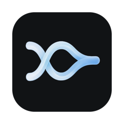
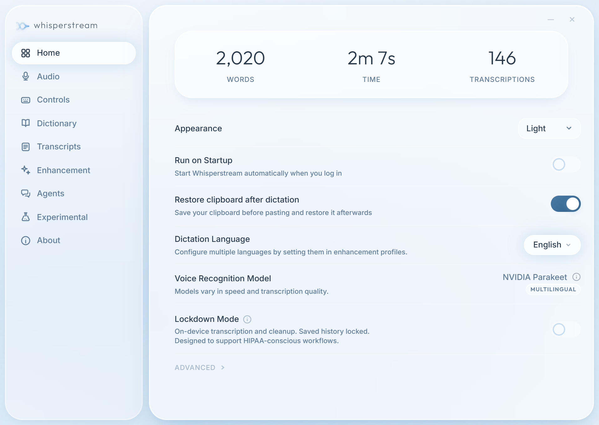

  
  <h1>Whisperstream</h1>
  
Private, local dictation for Windows and macOS.

  

    <a href="https://whisperstream.io">Website</a> •
    <a href="#-get-whisperstream">Download</a> •
    <a href="docs/development/building-from-source.md">Build from source</a>
  

⭐ If Whisperstream is useful to you, a star helps other people find it. ⭐

Whisperstream turns your speech into text in any app. Speech recognition runs on
your computer, so your voice never leaves it. Optional AI cleanup can run locally
too, or with your own API key after you agree to send text to that provider.
Everything is free, with no account or activation.

<picture>
  <source media="(prefers-color-scheme: dark)" srcset="docs/images/home-dark.png">
  
</picture>

## ✨ Highlights

- **On-device transcription:** Transcription runs locally on your CPU using NVIDIA Parakeet, Qwen3 ASR or Cohere Transcribe.
- **Stream-1 Mini:** A fine-tuned Qwen3 0.6B model, so local cleanup is quick and runs on most machines.
- **Cloud cleanup with your own key:** Gemini, OpenAI, Anthropic, Ollama or any compatible service.
- **Per-App Profiles:** Customize enhancement prompts for each app, with built-in profiles for Chat and Email.
- **Dictionary Boost:** Teach cleanup the names and terms you use.
- **Live Preview:** See words appear while you speak.
- **Transcript and voice history:** Search, replay and copy past dictations.
- **Lockdown Mode:** Keeps everything on your device and protects history with a password, for legal, health and other privacy-sensitive fields.
- **Managed Lockdown:** For organizations that need all data to stay local, with the option to turn off transcript and voice history.
- **Agent Speak:** Hear replies from Claude Code and Codex, and answer them by voice.

See the full feature tour at [whisperstream.io](https://whisperstream.io).

## 📥 Get Whisperstream

Download the free official installer from [whisperstream.io](https://whisperstream.io).
It's available for Windows, and macOS is in beta. The official Windows app
updates automatically.

Or you can [build it from source](docs/development/building-from-source.md).
Source builds don't update themselves, so you install new versions manually.

## 🔒 Privacy

Your audio is transcribed on your device and is never uploaded. Text leaves your
computer only when you turn on cloud cleanup and agree to send it to your chosen
provider.
There's no telemetry or analytics. The app does download speech models from public
hosts such as Hugging Face. Read the full [Privacy Policy](legal/PRIVACY.md).

## ⚙️ Technical details

Models download once from Hugging Face. Sizes are approximate.

- **Voice transcription:** [sherpa-onnx](https://github.com/k2-fsa/sherpa-onnx) runs int8 builds of:
  - [NVIDIA Parakeet TDT 0.6B](https://huggingface.co/nvidia/parakeet-tdt-0.6b-v3), v3 multilingual or [v2 English](https://huggingface.co/nvidia/parakeet-tdt-0.6b-v2) (about 670 MB). On macOS, Parakeet runs through [FluidAudio](https://github.com/FluidInference/FluidAudio).
  - [Qwen3 ASR 0.6B](https://huggingface.co/Qwen/Qwen3-ASR-0.6B) (about 990 MB).
  - [Cohere Transcribe](https://huggingface.co/CohereLabs/cohere-transcribe-03-2026) (about 2.9 GB).
- **Enhancement:** [llama.cpp](https://github.com/ggml-org/llama.cpp) runs GGUF models:
  - [Stream-1 Mini](https://huggingface.co/whisperstream/stream-1-mini), fine-tuned from [Qwen3 0.6B](https://huggingface.co/Qwen/Qwen3-0.6B-Base) (about 480 MB).
  - Customizable: [Gemma 4 E2B Instruct](https://huggingface.co/unsloth/gemma-4-E2B-it-GGUF), 4-bit (about 3.1 GB).
- **Agent Speak:** Connects through a [Claude Code plugin](https://code.claude.com/docs/en/plugins) and a [Codex plugin](https://learn.chatgpt.com/docs/plugins). Replies are spoken with sherpa-onnx using [Supertonic 3](https://huggingface.co/Supertone/supertonic-3) (about 145 MB) or [Kokoro 82M](https://huggingface.co/hexgrad/Kokoro-82M) (about 360 MB).

## 🧭 Status and support

Whisperstream is a free project I work on in my spare time. I'll try to keep it
maintained and look at issues when I can, but I can't promise support, response
times or fixes.

## 🐛 Issues and contributions

Bug reports and feature ideas are welcome in
[GitHub Issues](https://github.com/lanreal-io/whisperstream/issues/new/choose).
Please search existing issues first.

I'm not accepting pull requests right now. If you've found a fix, open an issue
and describe it. You're welcome to fork Whisperstream under the GPL.

Report security problems privately by email, not in a public issue. See
[SECURITY.md](SECURITY.md).

## 📄 Licence and credits

Whisperstream is licensed under [GPL-3.0-only](LICENSE). Copyright Lanreal
Technologies Inc.

Third-party components, models and assets keep their own licences.

- [NOTICE](NOTICE)
- [AUTHORS.md](AUTHORS.md)
- [Third-party notices](THIRD_PARTY_LICENSES.txt)
- [Asset review](docs/open-source-assets.md)
